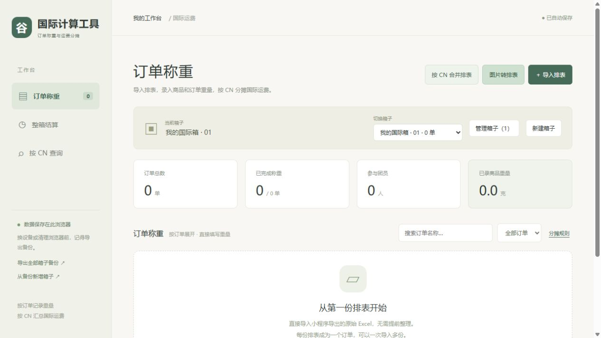
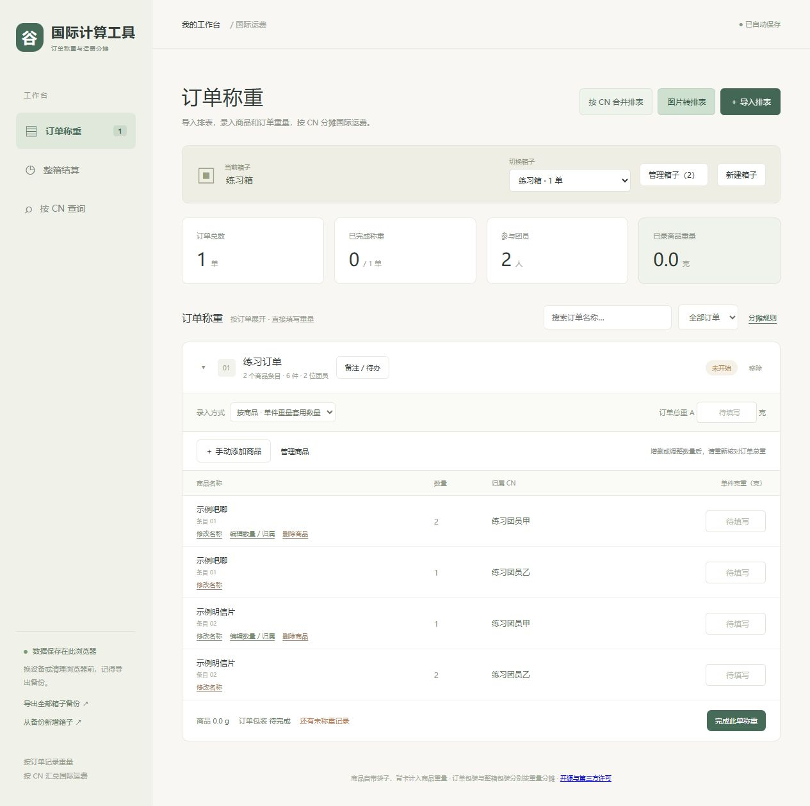
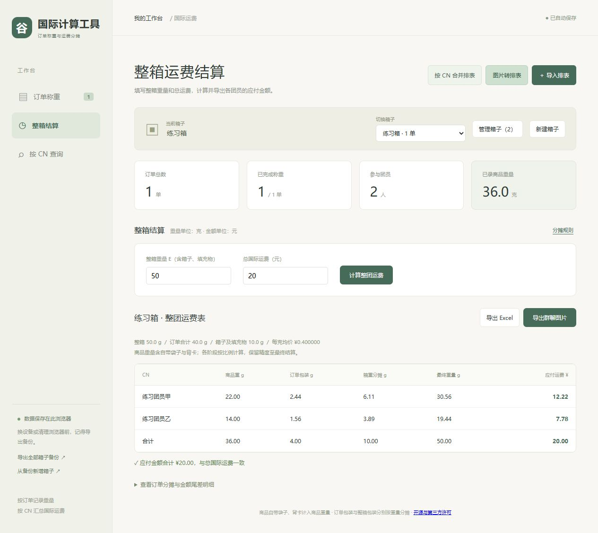

# 谷里新手使用指南

这份教程不要求你会写代码。照着按钮名称一步一步操作即可。

页面里的 **CN** 就是团员昵称；**订单** 通常对应一份排表；**箱子** 则装着这次一起寄出的多个订单。先把各单记录好，最后再计算整箱运费。

## 先确认：你现在在哪一步

- **已经看到“国际计算工具”页面**：直接从下面第一步开始。
- **手上只有一个下载的 ZIP 文件**：先看 [Windows 首次启动](WINDOWS_START.md)。

## 开始前准备什么

1. 小程序导出的原始 Excel 排表，一般后缀是 `.xlsx`。不用先排版，也不要把截图直接改名成 xlsx。
2. 能称出商品和包裹重量的秤。教程和页面的重量单位都是 **克**。
3. 每个订单拆分前的总重量，以及分给每个人的商品重量。可以先拍照，之后再录入。
4. 全部装好后整箱的重量，以及这一箱实际支付的国际运费。

缺少某个重量时，可以先留空，之后补填；不要用 0 代替“还没称”。所有记录只存在当前浏览器，建议固定使用同一个浏览器。

如果秤显示千克，先换算成克：例如 1.25 kg 要填写 1250。输入框只填数字，不必再输入“克”或“元”。

## 想先练习：照这组数字填一遍

下载包的 `examples` 文件夹里有 **练习排表.xlsx**，只有两位虚构团员。它与页面里的“示例数据”是两份不同的练习，不要混在同一个箱子计算。

1. 点击“新建箱子”，输入 `练习箱`，点击“创建并切换”。
2. 点击右上角“＋ 导入排表”，选择 `examples/练习排表.xlsx`。
3. 页面应出现一个“练习订单”，两种商品、两位团员，共 6 件。
4. 在两位团员各自的“示例吧唧”行，把“单件克重”都填成 **10**。
5. 在两位团员各自的“示例明信片”行，把“单件克重”都填成 **2**。
6. “订单总重 A”填写 **40**，然后点击“完成此单称重”。
7. 点击侧栏“整箱结算”。整箱重量填写 **50**，总国际运费填写 **20**。
8. 点击“计算整团运费”。结果应为：练习团员甲 **12.22 元**、练习团员乙 **7.78 元**，合计 **20.00 元**。
9. 试着点击“导出 Excel”，确认浏览器下载了一份运费表。
10. 练习结束后，新建一个正式箱子再录入自己的排表。练习箱可以在“管理箱子”里归档。

## 第一步：建立这次要计算的箱子

1. 找到页面上方“当前箱子”。第一次使用一般显示“我的国际箱 · 01”。
2. 可以直接点击箱子名称并改名，例如 `十一月第一箱`，修改会自动保存。
3. 如果要保留之前的箱子，点击“新建箱子”，不要把旧箱子的商品删除后当新箱使用。
4. 输入一个自己能认出的名字，点击“创建并切换”。
5. 确认“当前箱子”显示刚刚填写的名称。

**判断是否成功：** 新箱子的订单总数是 0。新建箱子不会清空旧箱子。

## 第二步：导入自己的 Excel 排表

1. 点击右上角“＋ 导入排表”。
2. 在弹出的选文件窗口中，找到小程序导出的原始排表。
3. 点选文件，再点“打开”。需要导入多份时，可以按住 Ctrl 选择多份；不熟悉这个操作时，一份一份导入也可以。
4. 等待页面出现订单。
5. 对照原表检查商品名称、归属 CN、数量，以及订单中的总件数。
6. 在正确的箱子里继续导入其他订单；不需要为了每个订单新建一个箱子。

**判断是否成功：** “订单总数”增加，订单下方出现商品列表。一个商品分给多人时，会分别显示每个人的数量和克重输入框。

如果提示未识别到排表，确认原表里能找到“种类”和“昵称/总数”。当前工具不是任何格式的 Excel 都能自动理解。不要靠改文件后缀来转换格式。

## 第三步：录入订单重量和商品重量

1. 如果订单收起来了，点击它左边的小三角展开。
2. 在“订单总重 A”填写这一整个订单的实称重量，包含该订单原有的包装。例如这一单称出来 180 克，就填 `180`。
3. 正常逐件录入时，保留“按商品 · 单件重量套用数量”。
4. 根据商品名和 CN 找到对应行，在“单件克重”里填 **一件** 的重量。
5. 如果某人买 3 件，每件 11.7 克，就填 `11.7`，不要填 `35.1`。程序会自己乘数量。
6. 同款其他人的克重可逐行填写；某个人的物品实称不同，也可在那个人的行单独修改。
7. 自带袋子、背卡如果一起称重，就算在商品重里，不要再额外加一次。
8. 所有人都填写完后，查看订单底部是否仍有“还有未称重记录”等提醒。
9. 确认无误，点击“完成此单称重”。
10. 继续处理下一单。每单都要单独点一次完成。

**判断是否成功：** 订单右侧显示“已完成”，上方“已完成称重”的数量增加。

### 一整单只有一种商品，想统一填写

1. 找到订单顶部“统一单件克重（克）”。这个输入框只在订单有一个商品条目时出现。
2. 填写一个商品的重量。
3. 点击“按数量一键填充克重”。
4. 检查每个人的行。这个操作会覆盖这一商品之前给各人单独填的克重，需要的特殊重量请之后再改。
5. 核对订单总重后，点击“完成此单称重”。

### 已经把一个人的商品一起称好

1. 将“录入方式”改为“按人合称 · 填商品总重”。
2. 页面会按 CN 显示输入框。
3. 给每个人填写他在 **当前这个订单** 中所有商品加在一起的重量，不是跨订单的重量，也不是每件的重量。
4. 填写订单总重，核对后点击“完成此单称重”。

不要在录入一半时反复切换模式；确实需要切换时，重新检查当前模式下的所有数字。

## 第四步：发现多件、少件、名字不清楚时

- 多了商品：在该订单里点“＋ 手动添加商品”，填写名称、CN 和数量；重量可稍后补。
- 数量或归属错了：点击商品旁的“编辑数量 / 归属”，修改后保存。
- 商品名不够详细：点击“修改名称”，输入新名称并保存。
- 少了某件商品：确认是需要从本次分摊移除后，再点该商品的“删除商品”。删除后可以在“管理商品”的“已删除商品”中恢复。

**修改后要做什么：** 凡涉及商品、数量、归属或重量的变化，都重新核对订单总重及称重完成状态。不要为了让运费算出来，随意提高包裹重量。

## 第五步：记录备注和待办

1. 在订单标题旁点击“备注 / 待办”。
2. “订单备注”写给这单相关团员看的说明，例如“特典随商品一起发出”。这段话会出现在核对单上。
3. “团长待办”写自己需要处理的事，例如“缺一张卡，待联系卖家”。在输入框填写后点“添加待办”。
4. 事情办完后，勾选那条待办。移除错了可在“已移除的待办”中恢复。
5. 点击“保存并关闭”。只关掉窗口或点“取消”不会保存本次修改。
6. 页面出现待办提醒时，点击“查看待办”可集中检查。

待办不会发给团员，也不会阻止计算。结算前仍应自己确认缺件、补称等事项是否影响本次分摊。

这里的“团员核对单可见”是指备注会出现在你导出的核对单里，不会自动替你发送消息或把订单发到网上。

## 第六步：计算整箱运费

1. 先确认当前箱子的每一个订单都已完成称重。
2. 点击侧栏“整箱结算”。窄屏时，导航按钮会显示在页面上方。
3. “整箱重量 E”填写最终装好箱子的重量，包含所有商品、订单包装、外箱和填充物。
4. “总国际运费”填写这一箱的实际总运费，单位为元。它是整箱总额，不是每个人的金额。
5. 点击“计算整团运费”。
6. 查看每个 CN 的应付运费，以及表格底部合计。
7. 点击“导出 Excel”下载完整表格；点击“导出群聊图片”下载运费图片。人数多时可能生成多张。
8. 到浏览器右上角“下载”列表或电脑“下载”文件夹确认文件已保存。

**判断是否成功：** 页面显示运费明细，所有团员应付金额合计与输入的总国际运费一致。

### 常见计算提示

- “请先完成所有订单称重”：回到“订单称重”，找到未完成订单，补齐并点击“完成此单称重”。
- “订单总重小于商品总重”：检查有没有把总重填成单件重、件数乘了两次、单位填错，或输入错行。
- “整箱重量小于所有订单总重之和”：检查整箱重量、各单总重和本箱是否混入其他箱子的订单。
- 修改数字后：再点一次“计算整团运费”，不要沿用旧截图或旧 Excel。

## 第七步：查询某位团员并生成核对单

1. 点击侧栏或顶部导航“按 CN 查询”。
2. 在“成员 CN”输入名字的一部分。
3. 在下面的候选按钮里，点击这个人的 **完整名字**。只输入文字还不等于选中成员。
4. 查看他在哪些箱子有商品。多个箱子会额外显示跨箱商品总列表。
5. 如果要查已经归档的箱子，勾选“包含归档箱子”。
6. 点“下载 Excel”，下载这名团员的汇总和详细记录。
7. 或点“生成团员核对单”，先看预览中的 CN、箱子、订单分类、商品和数量。
8. 点击“下载第 1 页 PNG”。有第二页、第三页时，也分别点一次下载。
9. 把下载好的图片或 Excel 发给相应团员。

这张核对单是用来核对商品的，不是全团运费图片。核对单包含公开订单备注，不包含团长待办。未完成称重时，也能先核对商品数量。

## 第八步：备份，下次继续

1. 点击侧栏“导出全部箱子备份”；窄屏找不到时，进入“管理箱子”，点击“备份全部箱子”。
2. 浏览器会下载一个 `.json` 文件。这不是乱码，也不是要用 Excel 打开的表格，请原样保留。
3. 把它放进自己找得到的备份文件夹，可以在文件名里加上日期，保留多个版本。
4. 换电脑、换浏览器或更换网址前，再导出一次最新备份。
5. 到新页面点“从备份新增箱子”，选择 `.json` 文件，再点“打开”。
6. 等待箱子重新出现，切换几个箱子检查商品、重量和备注。

恢复会 **新增** 箱子，不会用备份覆盖现有箱子。同一份备份不要反复恢复，否则会产生带“恢复”字样的多份箱子，并被 CN 查询一起统计。

Excel 运费表、核对单 PNG 和原始排表都不能代替完整 `.json` 备份。清理浏览器数据前一定先备份。

## 第九步：整理已经完成的箱子

1. 点击“管理箱子”。
2. 在“使用中”找到想收起的箱子，点击“归档”。
3. 它会从日常切换列表收起，原有记录全部保留。
4. 想找回来时，进入“管理箱子 → 已归档”，点击“查看此箱”或“恢复箱子”。
5. 如果所有箱子都归档了，当前页面仍可能显示最后一个归档箱子和提示；可以新建正式箱子继续。

归档不表示已经收款或寄出，也不等于删除。

## 进阶：同名商品分散在很多分类中

适合这种情况：同一个 Excel 里有多个日期分类，但“一织”“大和”等商品重复出现，希望按 CN 汇总后作为一单录入。

1. 点击右上角“按 CN 合并排表”。
2. 点击“选择 Excel 排表”，选原始文件。
3. 检查界面显示的分类数、种类数、团员数和总件数。
4. 查看汇总表，需要时搜索某个 CN 对照原表。
5. 修改“汇总订单名称”，让自己能认出它。
6. 勾选“我已核对 CN、种类和总件数，确认合并为一个订单”。
7. 点击“确认并导入为一个订单”。如果只想另存汇总表，则点“下载汇总 Excel”。

只有名称完全相同的 CN 和种类才会合并。别名不会自动认成同一个人；看起来相似但实际不同的商品，也不要为了合并而强行改成同名。

## 进阶：只有排表图片，没有 Excel

1. 点击“图片转排表”，选择清晰的表格图片。
2. 找到“识别方式”，选“浏览器识别（备用，准确率较低）”。本源码包不包含“本机 PaddleOCR”的安装程序，不用填连接码。
3. 按界面提示检查表格边界、表头和归属行，开始识别。
4. 第一次加载识别组件可能比较慢，先等待进度，不要连续点击。
5. 对照原图，逐项修改商品名称、CN、数量及备注。短名字、小字和赠品标记尤其容易认错。
6. 核对总件数以及每个成员的归属；不确定的地方不要直接确认。
7. 确认无误后，勾选核对选项，点击界面底部的确认导入按钮。
8. 回到订单称重，检查新订单，再录入重量。

图片识别不能保证准确。复杂表格如果怎么改都难以核对，优先找回 Excel 排表，或先整理成当前工具支持的排表再导入。

## 出问题时怎么反馈

### 手机能不能用

如果有能打开的在线网址，可以用手机浏览器访问。这个下载包里的 Windows 启动文件不能在手机上运行；电脑上的 `127.0.0.1` 地址也不能发给手机当作共享网址。

记下你点了哪个按钮、期待出现什么、实际上出现了什么，以及浏览器名称。截图前遮住真实 CN、订单和其他个人信息。不要把完整备份文件发到公开讨论区。
